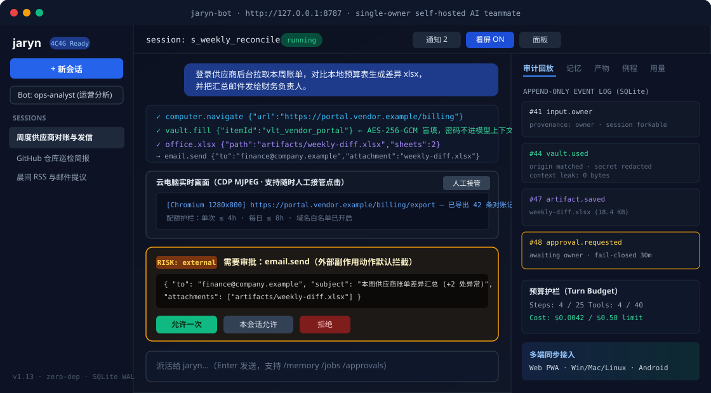

# jaryn-bot

**自托管的个人 AI 同事。** 一个跑在你自己服务器上的常驻智能体：它有自己的工作区和云电脑，能读写文件、跑命令、查网页、发邮件、生成 Office 文档表格、按计划主动干活；**密码凭据盲填不进模型上下文，危险动作先问你，全部过程可回放、可审计。**

[](https://github.com/ct-jaryn/jaryn-bot/releases/latest)
[](LICENSE)
[](https://nodejs.org)
[](docs/operations/testing.md)

设计目标是一台 **4C4G** 云服务器、单 owner、Web 优先、默认云模型 API（支持 DeepSeek 及任意 OpenAI 兼容接口）。不依赖外部数据库，**零第三方运行时 npm 依赖**，`node` 直接运行 TypeScript。



---

## 它和"聊天机器人"的区别

| 普通聊天机器人 | jaryn-bot |
|---|---|
| 只会回话 | 会**动手交付成果**：文件、终端、浏览器、邮件、`.docx`/`.xlsx`/`.pptx`、可分享页面 |
| 一个对话框 | **多个 Bot** 各有独立工作区、记忆命名空间、工具集与预算；可互相派子任务 |
| 你问才答 | **主动干活**：cron / RSS / HMAC webhook / 6 类信号提议，接受即执行 |
| 看不到黑盒过程 | **append-only 事件溯源**，每一步可回放、可分叉（fork）、可导出脱敏审计 |
| 账号密码暴露在提示词里 | **Vault 盲填**：AES-256-GCM write-only，模型看不见密码，只能调工具代填表单 |
| 跑在别人云上 | 你的机器、你的磁盘、你的模型 Key；高危动作默认逐次审批 |

## 快速开始（3 种方式按需选择）

### 方式一：Docker 一键启动（零环境依赖，最推荐）

宿主机无需安装 Node 环境，填入 `DEEPSEEK_API_KEY`（或任意 OpenAI 兼容 `OPENAI_API_KEY`）即可开箱即用：

```bash
git clone https://github.com/ct-jaryn/jaryn-bot.git && cd jaryn-bot
cp .env.example .env
# 编辑 .env：填入 DEEPSEEK_API_KEY=sk-... 与 JARY_API_TOKEN=<自定义访问口令>
docker compose -f deploy/docker-compose.yml up -d --build
# 打开 http://127.0.0.1:8787/?token=<你的JARY_API_TOKEN>
```

### 方式二：下载桌面 / 手机客户端

前往 [GitHub Releases](https://github.com/ct-jaryn/jaryn-bot/releases/latest) 直接下载对应平台安装包，指向你的自托管服务端地址即可配对使用：

- **Windows**：`jaryn.Setup.<ver>.exe`
- **macOS**：`jaryn-<ver>-arm64.dmg`（Apple Silicon）/ `jaryn-<ver>.dmg`（Intel）
- **Linux**：`.AppImage` / `.deb`
- **Android**：`.apk`（iOS 可直接将 Web 端添加到主屏幕以 PWA 运行）

### 方式三：本地源码直跑（Node 24+，无需 `npm install`）

```bash
git clone https://github.com/ct-jaryn/jaryn-bot.git && cd jaryn-bot
node scripts/link-workspaces.mjs

export DEEPSEEK_API_KEY=sk-...   # 自动启用真实模型；不设则默认使用离线 echo 演练模式
node packages/cli/src/index.ts init --home ./data-home
node packages/cli/src/index.ts doctor --home ./data-home
node packages/cli/src/index.ts serve --home ./data-home --port 8787
# → http://127.0.0.1:8787
```

> 也支持任意兼容 OpenAI Chat Completions 的模型服务（如 Qwen、vLLM、Ollama 等）：设置 `OPENAI_API_KEY`、`OPENAI_BASE_URL`、`OPENAI_MODEL` 环境变量即可自动接入。完整说明见 [快速开始](docs/getting-started.md) 与 [客户端指南](docs/guides/clients.md)。

## 核心能力

| 能力 | 说明 |
|---|---|
| **Web 工作台** | 流式对话、工具步骤、审批卡、问题卡、云电脑看屏接管、侧边面板（记忆/任务/页面/产物/例程/提议/用量/审计/通知） |
| **多 Bot 协作** | 每个 Bot 独立人格、工具集、工作区、记忆命名空间、预算；`spawn_worker` 派子任务与消息总线 |
| **持久化记忆** | SQLite FTS5 + bigram；每轮 ≤600 token 摘要注入；容量上限、衰减归档、TTL、定时整理 |
| **主动任务与移动提醒** | cron / every / webhook(HMAC) / RSS；持久目标多轮推进；6 类提议信号；通知中心（安静时段）+ [外置飞书/企微/Slack 审批提醒桥接示例](examples/webhook-notifier/README.md) |
| **云电脑（Browser/CDP）** | 本机 Chrome 或 Docker 容器；看屏（截图/SSE/screencast/MJPEG）、人工接管、输入、快照恢复、容器内终端；单次 4h/日 8h 配额与域名白名单 |
| **Vault 凭据盲填** | AES-256-GCM write-only、模型盲填、一次性 Secure Form、授权锁定、1Password/Bitwarden/TOTP、卡信息填表（默认关，不接支付网关） |
| **连接器 / 邮箱** | 通用 HTTP + OAuth（授权/回调/刷新）、Gmail/Calendar 示例、SMTP（TLS/STARTTLS/附件）、IMAP 收信 |
| **产物与 Office** | artifact 库、Pages（版本/回滚/分享 TTL）、docx/xlsx/pptx（纯 TS 原生生成，零外部依赖） |
| **多端客户端** | Web/PWA、Electron（Win/Mac/Linux 安装包）、Android APK；设备配对限次与令牌一键吊销；`/ws/client` JSON-RPC |
| **工程与评测** | 350 行自研插件微内核（组合 + patch + 权限扫描 + 进程外宿主）、12 项多步办公基准评测（`evals/`）、CI 全平台打包、文档与代码清单自动对账 |

## 架构

```
               浏览器 / Electron / Android / CLI
                            │  HTTP · SSE · /ws/client
                    ┌───────▼────────┐
                    │  jary serve     │  单进程 · 零运行时第三方依赖
                    │  ├ 插件内核      │  profile → bundle → patch
                    │  ├ Agent 循环    │  74 工具 · 6 级审批 · 预算护栏
                    │  ├ 事件溯源      │  append-only + replay / fork
                    │  └ 调度/记忆/通知 │
                    └───┬────────┬────┘
                        │        │
              SQLite(WAL)   云电脑（每 Bot 隔离）
              $JARY_HOME    Chrome / Docker + CDP
```

细节：[架构设计](docs/design/architecture.md) · [核心概念](docs/concepts.md) · [插件指南](docs/guides/plugins.md) · [外置 Webhook 提醒示例](examples/webhook-notifier/README.md)。

## 文档导航

| 入口 | 内容 |
|---|---|
| [快速开始](docs/getting-started.md) | Docker / 客户端 / 源码安装、配置模型、第一次派活、验证 |
| [核心概念](docs/concepts.md) | 会话/事件、工具、审批、Bot、云电脑、Vault 的心智模型 |
| [使用指南](docs/README.md#使用指南) | Web UI、客户端、记忆、主动任务、云电脑、Vault、连接器/邮箱、Pages/产物、插件 |
| [参考手册](docs/reference/cli.md) | [CLI](docs/reference/cli.md) · [HTTP/WS API](docs/reference/http-api.md) · [工具清单](docs/reference/tools.md) · [配置](docs/reference/configuration.md) · [事件](docs/reference/events.md) |
| [运维指南](docs/operations/deployment.md) | [部署](docs/operations/deployment.md) · [自动打包](docs/operations/release.md) · [安全](docs/operations/security.md) · [测试](docs/operations/testing.md) · [排错](docs/operations/troubleshooting.md) |
| [设计档案](docs/design/architecture.md) | [架构](docs/design/architecture.md) · [决策与边界](docs/design/decisions.md) · [能力审计](docs/design/audit.md) |
| [更新记录](CHANGELOG.md) | 各版本变更记录 |

## 开发与校验

```bash
npm test          # 全量测试（串行；含真实 Chrome、TLS、WS、SQLite）
npm run check     # docs + deploy + desktop + inventory + evals 结构校验
npm run smoke     # CLI 端到端冒烟
npm run inventory # 重新生成 docs/reference/inventory.md 与 docs/reference/tools.md
npm run eval      # 12 项拟真多步任务评测（需 DEEPSEEK_API_KEY 或 OPENAI_API_KEY）
```

无运行时 npm 依赖、无编译步骤：Node 24+ 直接运行 `.ts`；`node scripts/link-workspaces.mjs` 建立包间链接（`npm test` 会自动执行）。

## 安全与边界

- 网络默认只绑 `127.0.0.1`；公网部署必须配置反代 TLS（仓库附带 [Caddyfile](deploy/Caddyfile)）与 `JARY_API_TOKEN`。详见 [安全指南](docs/operations/security.md)。
- 风险模型：`read`/`write`/`network` 自动允许，`execute`/`external`/`destructive` 默认逐次审批；后台无人值守任务遇到需审批动作零容忍立即拒绝（可用 allow 规则预批）。
- 内核明确不做（Won't）：真实支付网关/结算、内核耦合 IM SDK（可通过 [外置 Webhook 桥接脚本](examples/webhook-notifier/README.md) 推送移动提醒）、团队会议/多租户企业管控、原生 iOS、真 WebRTC。详见 [决策与边界](docs/design/decisions.md)。
- 安全漏洞请按 [SECURITY.md](SECURITY.md) 私下报告。

## 与 Grok Bot 的关系

产品形态参考 [Grok Bot](https://docs.x.ai/grok-bot/overview)（xAI）：**灵感来源，100% 原创实现**，不包含其任何代码或资源，与 xAI 无隶属或背书关系；"Grok"、"Grok Bot" 商标归其各自所有者。见 [NOTICE.md](NOTICE.md)。

## 许可

**AGPL-3.0 + 商业双许可**：

- **个人自托管免费**：个人学习、研究及私人服务器自用完全免费，无需公开你的任何个人数据、提示词或配置。
- **商业与 OEM 授权**：将本项目内核/组件闭源嵌入商业软件或硬件、对外提供 SaaS/托管服务、或企业内部闭源定制部署，请联系作者获取商业授权，详见 [COMMERCIAL.md](COMMERCIAL.md)。欢迎提交贡献，见 [CONTRIBUTING.md](CONTRIBUTING.md)。

> 项目持续快速演进，按现状提供且不含担保；生产环境使用前请结合组织要求评估安全与合规。

---

## English

**jaryn-bot** is a self-hosted personal AI teammate runtime. It runs on your own server with its own workspace and cloud computer: files, terminal, browser, email, Office documents (`.docx`/`.xlsx`/`.pptx`), web pages, scheduled and proactive work — with **AES-256-GCM blind credential filling** (passwords never enter model context), human approval cards for risky actions, and an **append-only event log** for full replay and audit.

Single-owner, Web-first, 4C4G-friendly, no external database, **zero runtime npm dependencies** (Node 24+ executes TypeScript natively, or one-command Docker Compose). Simply set `DEEPSEEK_API_KEY` or any OpenAI-compatible `OPENAI_API_KEY` to start. CI packages Windows, macOS (`arm64`/`x64`), Linux, and Android installers with SHA256 checksums on every release tag.

Start at [docs/README.md](docs/README.md). Dual-licensed under **AGPL-3.0** (free for personal self-hosting) and a **Commercial / OEM License** ([COMMERCIAL.md](COMMERCIAL.md)). Original implementation inspired by Grok Bot — no affiliation.
